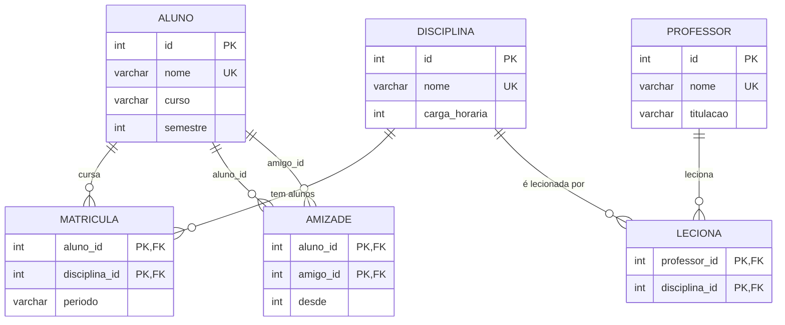

# Comparativo com o banco relacional

O mesmo caso (rede social acadêmica) foi modelado em SQL e carregado com **exatamente os mesmos dados** do grafo. Arquivos: [`sql/01_schema.sql`](../sql/01_schema.sql), [`sql/02_carga.sql`](../sql/02_carga.sql) e [`sql/03_consultas.sql`](../sql/03_consultas.sql).

## Diagrama ER



## Criação das tabelas

O script completo está em [`sql/01_schema.sql`](../sql/01_schema.sql). Resumo do que o relacional exigiu:

- **6 tabelas** (3 entidades e 3 tabelas de ligação) e **1 view** (`amizade_bi`), contra 3 tipos de nó e 3 tipos de aresta no grafo.
- Uma tabela de ligação para cada relação N:N (`matricula`, `leciona`, `amizade`).
- A view `amizade_bi` existe só para consultar a amizade nos dois sentidos; no Cypher bastou omitir a seta.

## Duas consultas reescritas em SQL

### C3: amigos de amigos (sugestão de amizades para a Ana)

**Cypher**

```cypher
MATCH (ana:Aluno {nome: "Ana Costa"})-[:AMIGO_DE]-(amigo:Aluno)-[:AMIGO_DE]-(sugestao:Aluno)
WHERE sugestao <> ana AND NOT (ana)-[:AMIGO_DE]-(sugestao)
RETURN sugestao.nome AS sugestao, count(DISTINCT amigo) AS amigos_em_comum
ORDER BY amigos_em_comum DESC, sugestao;
```

**SQL**

```sql
SELECT fof.nome AS sugestao, COUNT(DISTINCT f1.b) AS amigos_em_comum
FROM aluno ana
JOIN amizade_bi f1 ON f1.a = ana.id
JOIN amizade_bi f2 ON f2.a = f1.b
JOIN aluno fof     ON fof.id = f2.b
WHERE ana.nome = 'Ana Costa'
  AND fof.id <> ana.id
  AND NOT EXISTS (SELECT 1 FROM amizade_bi x WHERE x.a = ana.id AND x.b = fof.id)
GROUP BY fof.nome
ORDER BY amigos_em_comum DESC, sugestao;
```

### C5: disciplinas recomendadas (o que os amigos cursam e a Ana não)

**Cypher**

```cypher
MATCH (ana:Aluno {nome: "Ana Costa"})-[:AMIGO_DE]-(amigo:Aluno)-[:MATRICULADO_EM]->(d:Disciplina)
WHERE NOT (ana)-[:MATRICULADO_EM]->(d)
RETURN d.nome AS disciplina_recomendada, count(DISTINCT amigo) AS amigos_que_cursam
ORDER BY amigos_que_cursam DESC, disciplina_recomendada;
```

**SQL**

```sql
SELECT d.nome AS disciplina_recomendada, COUNT(DISTINCT f.b) AS amigos_que_cursam
FROM aluno ana
JOIN amizade_bi f ON f.a = ana.id
JOIN matricula m  ON m.aluno_id = f.b
JOIN disciplina d ON d.id = m.disciplina_id
WHERE ana.nome = 'Ana Costa'
  AND NOT EXISTS (SELECT 1 FROM matricula x WHERE x.aluno_id = ana.id AND x.disciplina_id = d.id)
GROUP BY d.nome
ORDER BY amigos_que_cursam DESC, disciplina_recomendada;
```

Os dois bancos devolvem o mesmo resultado (veja [`resultados.md`](resultados.md)). O SQL foi executado e conferido contra um cálculo independente.

### Extra: caminho mais curto (ponto forte do grafo)

No Cypher é `shortestPath((a)-[:AMIGO_DE*]-(b))`, uma linha. No SQL é uma CTE recursiva com cerca de 18 linhas e controle manual de ciclos (concatenando os nomes já visitados). Está em `sql/03_consultas.sql`.

## Diferenças observadas

| Critério | Neo4j (grafo) | SQL (relacional) |
|---|---|---|
| Estrutura | 3 tipos de nó e 3 de aresta | 6 tabelas e 1 view |
| Amigos de amigos | 1 padrão de caminho | 3 JOINs, `NOT EXISTS` e `GROUP BY` |
| Recomendação de disciplinas | 1 padrão de caminho | 3 JOINs, `NOT EXISTS` e `GROUP BY` |
| Menor caminho | `shortestPath`, 1 linha | CTE recursiva, controle manual de ciclos |
| Nova propriedade (e-mail) | `SET`, sem alterar a estrutura | `ALTER TABLE`, a coluna passa a existir para todos |
| Excluir um aluno | `DETACH DELETE` (1 comando) | `DELETE` em `matricula`, `amizade` e `aluno`, nessa ordem, por causa das chaves estrangeiras |

## Conclusão: neste caso, qual modelo é melhor e por quê?

Para este caso, o modelo de grafos é melhor. As perguntas centrais do sistema (sugerir amigos de amigos, recomendar disciplinas pelos amigos, achar o caminho entre dois alunos) são travessias: partem de um aluno e seguem conexões. No grafo, a conexão é um dado armazenado e a consulta descreve o padrão do caminho. No relacional, cada salto vira um JOIN, e o caminho mais curto exige uma CTE recursiva com controle manual de ciclos. Na prática, as consultas C3 e C5 passaram de um padrão de caminho para três JOINs, um `NOT EXISTS` e um `GROUP BY`, e o relacional ainda precisou de uma view só para tratar a amizade nos dois sentidos. O esquema também é mais flexível: adicionamos `email` com um `SET`, enquanto no SQL foi preciso um `ALTER TABLE`.

Com 20 alunos a diferença de desempenho é imperceptível, então o ganho que observamos aqui é de clareza e de manutenção das consultas, não de velocidade. Em redes grandes e consultas com muitos saltos, andar direto pelas arestas tende a escalar melhor do que encadear JOINs, mas isso não foi medido neste trabalho.

O relacional continua melhor quando o foco é integridade e relatórios sobre tabelas inteiras, como média de notas por disciplina ou total de matrículas por semestre, e também em transações com regras rígidas. Se um sistema acadêmico real precisasse disso (histórico, notas, financeiro), uma boa arquitetura seria usar o relacional como base e o grafo na camada de rede social e recomendação.
