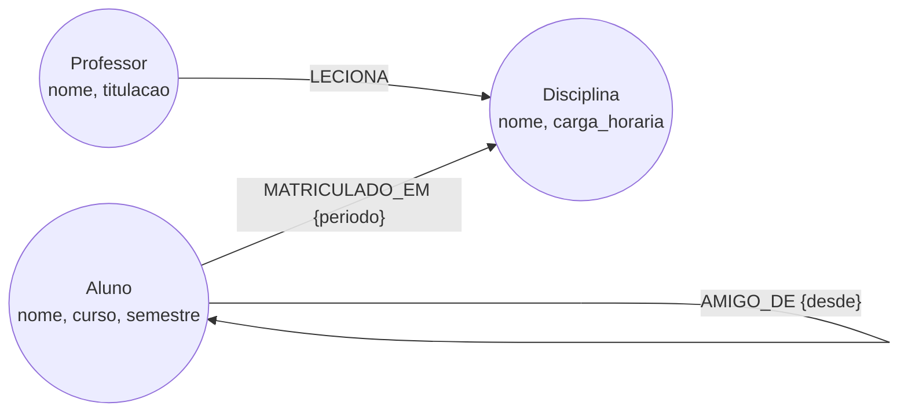

# Modelagem dos dados (grafo)

## Desenho



Em Cypher, o mesmo desenho fica assim:

```
(:Professor)-[:LECIONA]->(:Disciplina)<-[:MATRICULADO_EM]-(:Aluno)-[:AMIGO_DE]-(:Aluno)
```

## Dicionário

| Elemento | Tipo | Propriedades |
|---|---|---|
| `Aluno` | nó | `nome` (único), `curso`, `semestre` (e `email`, criado na operação de atualização) |
| `Disciplina` | nó | `nome` (único), `carga_horaria` |
| `Professor` | nó | `nome` (único), `titulacao` |
| `MATRICULADO_EM` | aresta Aluno → Disciplina | `periodo` (ex.: "2026.2") |
| `LECIONA` | aresta Professor → Disciplina | nenhuma |
| `AMIGO_DE` | aresta Aluno → Aluno | `desde` (ano) |

Carga: **20 alunos + 8 disciplinas + 5 professores = 33 nós**, e 8 + 60 + 31 = **99 arestas**.

## Índices e restrições

Há uma restrição de unicidade em `Aluno.nome`, `Disciplina.nome` e `Professor.nome`. No Neo4j ela também cria um índice, então `MATCH (:Aluno {nome: "Ana Costa"})` encontra o ponto de partida sem varrer todos os nós.

## Decisões de modelagem

- **Amizade gravada uma única vez** (`A -[:AMIGO_DE]-> B`). Nas consultas escrevemos `-[:AMIGO_DE]-` sem seta, e o grafo trata a amizade como mútua. Isso evita duplicar dados e evita inconsistência (A amigo de B, mas B não amigo de A).
- **`periodo` na aresta de matrícula.** O período pertence à relação entre aluno e disciplina, não ao aluno nem à disciplina.
- **`curso` como propriedade, não como nó.** Mantém o modelo pequeno. Se o sistema precisasse perguntar "quais alunos do mesmo curso são amigos", valeria transformar `Curso` em nó.

## Perguntas que o sistema precisa responder e como a modelagem ajuda

| # | Pergunta do sistema | Como a modelagem facilita |
|---|---|---|
| C1 | Quais disciplinas a Ana cursa e quem leciona cada uma? | Dois saltos seguindo as arestas `MATRICULADO_EM` e `LECIONA`; não há tabela de ligação para cruzar |
| C2 | Quantos alunos tem cada turma e qual o professor? | O nó `Disciplina` é o ponto de encontro das duas relações; basta contar as arestas que chegam nele |
| C3 | Quem a Ana pode conhecer (amigos de amigos), ordenado por amigos em comum? | `AMIGO_DE` é uma aresta de primeira classe: o padrão `(a)-[:AMIGO_DE]-()-[:AMIGO_DE]-(sugestão)` é a própria pergunta |
| C4 | Quais colegas têm mais disciplinas em comum com a Ana (grupo de estudo)? | A disciplina é um nó compartilhado; ir da Ana até a disciplina e voltar até outro aluno encontra os colegas |
| C5 | Que disciplinas os amigos da Ana cursam e ela ainda não? | Combina duas relações (`AMIGO_DE` e `MATRICULADO_EM`) em um só padrão, algo comum em recomendação |
| C6 | Qual o menor caminho de amizades entre dois alunos? | O grafo guarda as conexões, então `shortestPath` percorre as arestas sem precisar saber o tamanho da cadeia de antemão |
| CRUD | Matricular, trocar de disciplina, adicionar e-mail, excluir aluno | Criar ou apagar uma relação é uma operação isolada; `DETACH DELETE` remove o nó e todas as arestas dele; propriedades novas não exigem alterar a estrutura |
