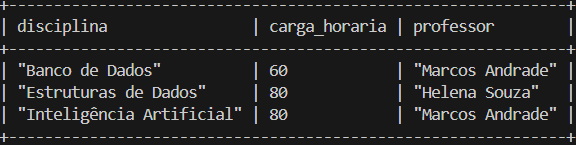
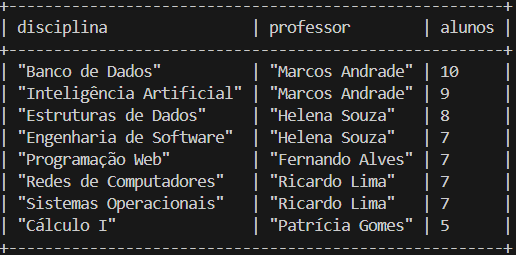
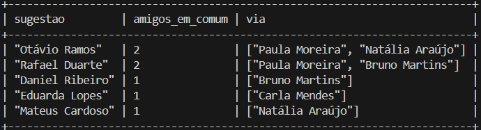
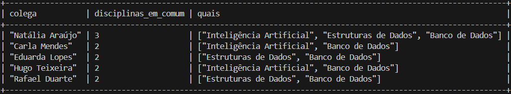
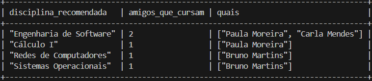
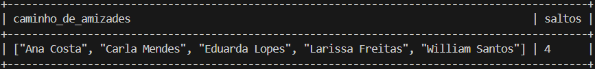
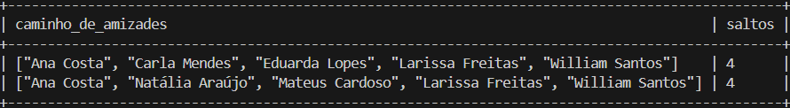
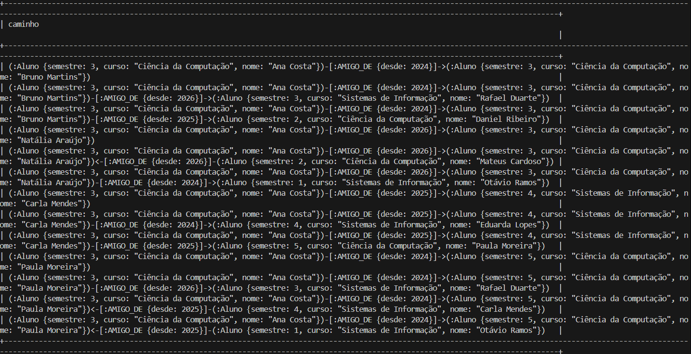

# Consultas e resultados

Cada consulta abaixo traz o **comando** (idêntico ao de `cypher/03_consultas.cypher`), o **resultado** e o **print** da execução no Neo4j 5 via `cypher-shell`. As consultas C3 e C5 devolvem o mesmo resultado na versão em SQL (`sql/03_consultas.sql`).

> Quando uma consulta usa `collect(...)`, a ordem dos nomes dentro da lista pode variar entre execuções; o conteúdo é o mesmo.

---

## C1. Disciplinas da Ana e quem leciona cada uma

```cypher
MATCH (:Aluno {nome: "Ana Costa"})-[:MATRICULADO_EM]->(d:Disciplina)<-[:LECIONA]-(p:Professor)
RETURN d.nome AS disciplina, d.carga_horaria AS carga_horaria, p.nome AS professor
ORDER BY disciplina;
```

| disciplina | carga_horaria | professor |
|---|---|---|
| Banco de Dados | 60 | Marcos Andrade |
| Estruturas de Dados | 80 | Helena Souza |
| Inteligência Artificial | 80 | Marcos Andrade |



---

## C2. Ranking de turmas (alunos por disciplina)

```cypher
MATCH (a:Aluno)-[:MATRICULADO_EM]->(d:Disciplina)<-[:LECIONA]-(p:Professor)
RETURN d.nome AS disciplina, p.nome AS professor, count(a) AS alunos
ORDER BY alunos DESC, disciplina;
```

| disciplina | professor | alunos |
|---|---|---|
| Banco de Dados | Marcos Andrade | 10 |
| Inteligência Artificial | Marcos Andrade | 9 |
| Estruturas de Dados | Helena Souza | 8 |
| Engenharia de Software | Helena Souza | 7 |
| Programação Web | Fernando Alves | 7 |
| Redes de Computadores | Ricardo Lima | 7 |
| Sistemas Operacionais | Ricardo Lima | 7 |
| Cálculo I | Patrícia Gomes | 5 |



---

## C3. Amigos de amigos (sugestão de amizades para a Ana)

```cypher
MATCH (ana:Aluno {nome: "Ana Costa"})-[:AMIGO_DE]-(amigo:Aluno)-[:AMIGO_DE]-(sugestao:Aluno)
WHERE sugestao <> ana AND NOT (ana)-[:AMIGO_DE]-(sugestao)
RETURN sugestao.nome AS sugestao,
       count(DISTINCT amigo) AS amigos_em_comum,
       collect(DISTINCT amigo.nome) AS via
ORDER BY amigos_em_comum DESC, sugestao;
```

| sugestao | amigos_em_comum | via |
|---|---|---|
| Otávio Ramos | 2 | Natália Araújo, Paula Moreira |
| Rafael Duarte | 2 | Bruno Martins, Paula Moreira |
| Daniel Ribeiro | 1 | Bruno Martins |
| Eduarda Lopes | 1 | Carla Mendes |
| Mateus Cardoso | 1 | Natália Araújo |



---

## C4. Grupo de estudo (colegas com mais disciplinas em comum com a Ana)

```cypher
MATCH (ana:Aluno {nome: "Ana Costa"})-[:MATRICULADO_EM]->(d:Disciplina)<-[:MATRICULADO_EM]-(colega:Aluno)
WHERE colega <> ana
RETURN colega.nome AS colega,
       count(d) AS disciplinas_em_comum,
       collect(d.nome) AS quais
ORDER BY disciplinas_em_comum DESC, colega
LIMIT 5;
```

| colega | disciplinas_em_comum | quais |
|---|---|---|
| Natália Araújo | 3 | Banco de Dados, Estruturas de Dados, Inteligência Artificial |
| Carla Mendes | 2 | Banco de Dados, Inteligência Artificial |
| Eduarda Lopes | 2 | Banco de Dados, Estruturas de Dados |
| Hugo Teixeira | 2 | Banco de Dados, Inteligência Artificial |
| Rafael Duarte | 2 | Banco de Dados, Estruturas de Dados |

O `LIMIT 5` corta mais dois colegas empatados com 2 disciplinas (Sofia Carvalho e William Santos).



---

## C5. Disciplinas recomendadas (o que os amigos da Ana cursam e ela não)

```cypher
MATCH (ana:Aluno {nome: "Ana Costa"})-[:AMIGO_DE]-(amigo:Aluno)-[:MATRICULADO_EM]->(d:Disciplina)
WHERE NOT (ana)-[:MATRICULADO_EM]->(d)
RETURN d.nome AS disciplina_recomendada,
       count(DISTINCT amigo) AS amigos_que_cursam,
       collect(DISTINCT amigo.nome) AS quais
ORDER BY amigos_que_cursam DESC, disciplina_recomendada;
```

| disciplina_recomendada | amigos_que_cursam | quais |
|---|---|---|
| Engenharia de Software | 2 | Carla Mendes, Paula Moreira |
| Cálculo I | 1 | Paula Moreira |
| Redes de Computadores | 1 | Bruno Martins |
| Sistemas Operacionais | 1 | Bruno Martins |



---

## Ponto forte do tipo: caminho entre nós (C6)

```cypher
MATCH caminho = shortestPath(
  (:Aluno {nome: "Ana Costa"})-[:AMIGO_DE*]-(:Aluno {nome: "William Santos"})
)
RETURN [n IN nodes(caminho) | n.nome] AS caminho_de_amizades,
       length(caminho) AS saltos;
```

| caminho_de_amizades | saltos |
|---|---|
| Ana Costa, Carla Mendes, Eduarda Lopes, Larissa Freitas, William Santos | 4 |

Existem **dois** caminhos de 4 saltos. `shortestPath` devolve um deles (pode ser qualquer um); a variante `allShortestPaths`, também no arquivo de consultas, devolve os dois:

1. Ana Costa, Carla Mendes, Eduarda Lopes, Larissa Freitas, William Santos
2. Ana Costa, Natália Araújo, Mateus Cardoso, Larissa Freitas, William Santos



Print da variante `allShortestPaths` (C6b), com os dois caminhos:



Consulta extra: vizinhança da Ana até 2 saltos de amizade (no Neo4j Browser ela aparece desenhada como grafo):

```cypher
MATCH caminho = (:Aluno {nome: "Ana Costa"})-[:AMIGO_DE*1..2]-(:Aluno)
RETURN caminho;
```



---

## Operações (`cypher/02_operacoes_crud.cypher`)

| Passo | Operação | Resultado obtido |
|---|---|---|
| 1 a 3 | Criar a aluna Yasmin Prado, matriculá-la em 2 disciplinas e criar uma amizade com a Ana | 1 nó e 3 relações criados |
| 4 | Consultar a Yasmin e suas disciplinas | semestre 1; Banco de Dados e Cálculo I |
| 5 | Amigos da Yasmin | Ana Costa |
| 6 | Alunos de Ciência da Computação do 4º semestre em diante | Paula Moreira (5), Sofia Carvalho (4) |
| 7 | `SET` de semestre e e-mail | semestre 2 e `yasmin.prado@faculdade.edu` |
| 8 e 9 | Trocar Cálculo I por Programação Web | Banco de Dados e Programação Web |
| 10 | Atualizar a propriedade `desde` da amizade | 2025 |
| 11 | Excluir a relação de amizade | 1 relação excluída |
| 12 | `DETACH DELETE` da Yasmin | nó e relações restantes excluídos |
| 13 | Conferência | `yasmin_existe` = 0 e `total_de_alunos` = 20 |

Saída completa da execução: [`prints/crud.txt`](../prints/crud.txt)

